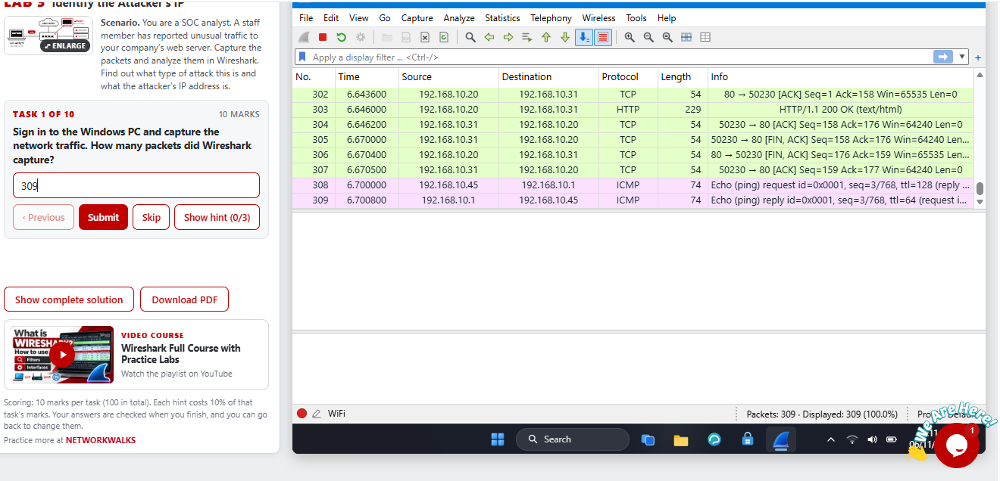
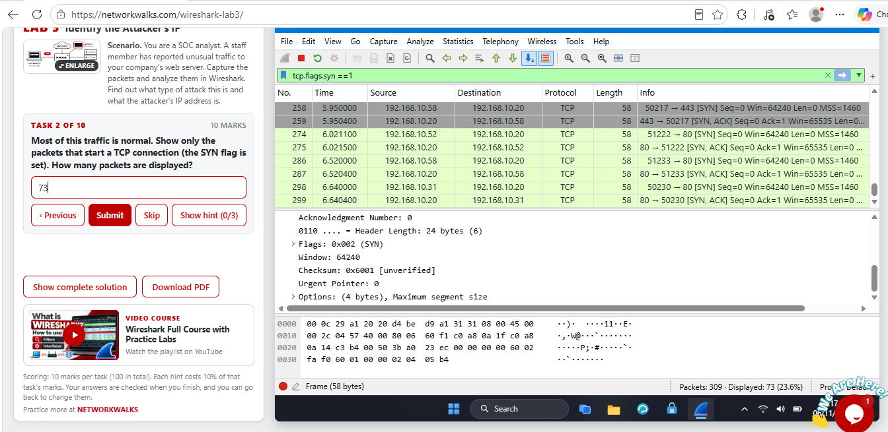
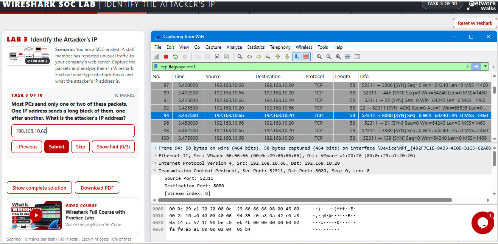
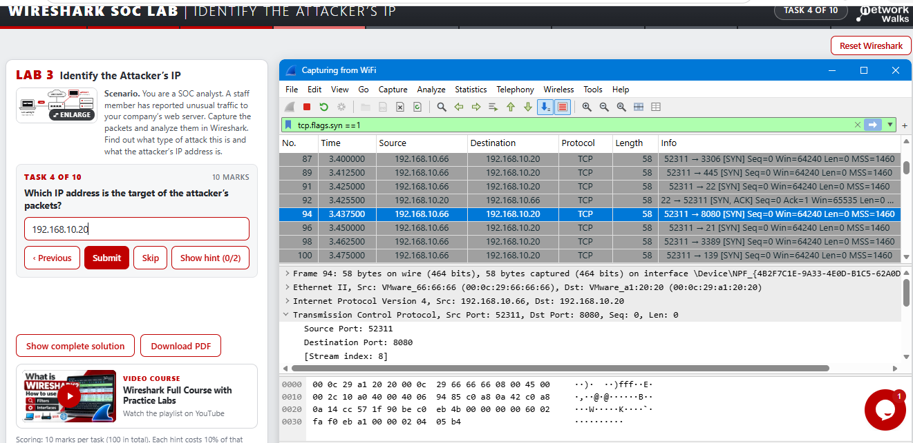
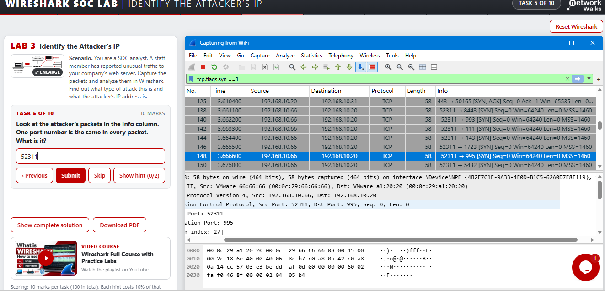
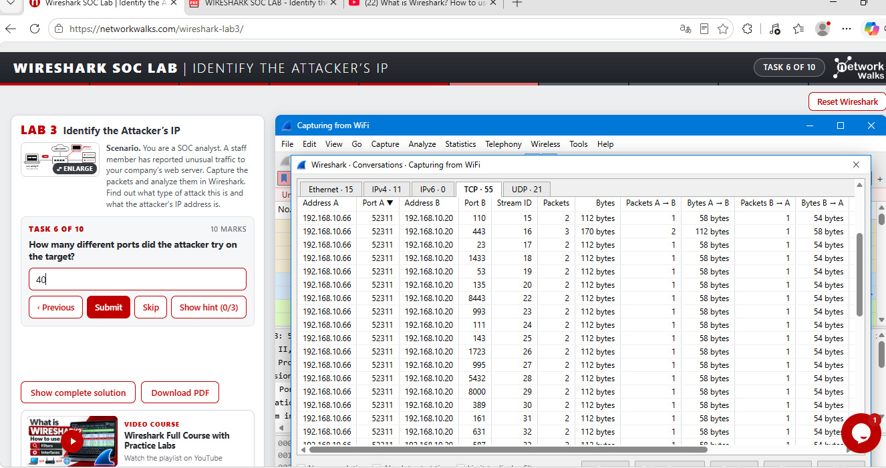
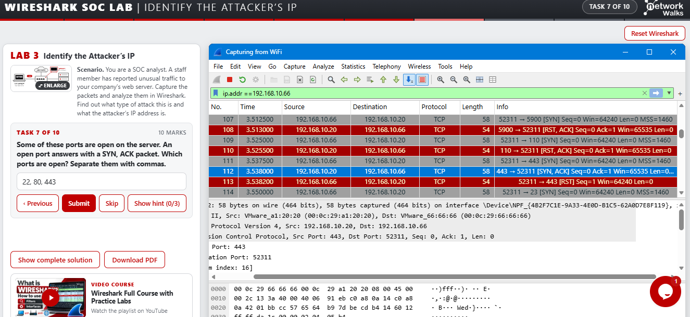
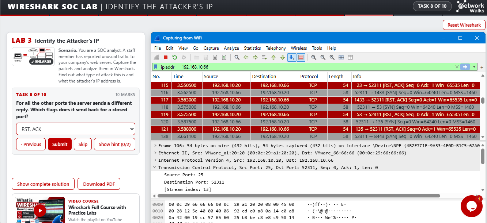

# NETWORKWALKS-CHINENYEPRECIOUS-B084-WK1-Extra-WIRESHARK-NETWORK-TRAFFIC-ANALYSIS

Project Category: Cybersecurity | Network Analysis | Wireshark | SOC Analysis
Difficulty: Beginner
Training Platform: Networkwalks
Lab: Wireshark Lab 3
Status: Completed

# Project Overview

As part of the Networkwalks Wireshark Lab 3 challenge, I completed practical exercises designed to strengthen my understanding of network traffic analysis, TCP communication, packet filtering, and the investigation of potentially suspicious network activities.

This project provided hands-on experience using Wireshark to capture and examine network packets, apply display filters, and interpret basic network communication.

# Project Objectives
Capture network traffic using Wireshark.
Understand how to inspect captured packets.
Apply display filters to isolate specific network traffic.
Identify TCP connection initiation using SYN flags.
Analyze communication between source and destination IP addresses.
Investigate network traffic patterns.
Develop practical network security monitoring skills.

Tools and Technologies

Wireshark: Network protocol analyzer used to capture and inspect network packets.
Windows PC: Host operating system.
TCP/IP: Network communication protocol suite.
Wireshark Display Filters: Used to isolate and examine specific packets.
Practical Exercises and Findings
# Task 1: Capturing Network Traffic

Objective:
Capture network traffic and determine the total number of packets recorded by Wireshark.

Procedure:

Opened Wireshark on the Windows PC.
Selected the active Wi-Fi network interface.
Started capturing network traffic.
Allowed the capture to run.
Checked the total packet count.

Result: 
Wireshark successfully captured 309 packets.

Screenshot Evidence:

# Task 2: Filtering TCP SYN Packets

Objective: Filter the captured traffic to display packets with the TCP SYN flag set.

Display Filter Used:

wireshark
tcp.flags.syn == 1

Procedure:

Entered the TCP SYN display filter into Wireshark.
Applied the filter to the captured traffic.
Examined the filtered packets.
Checked the number of packets displayed.

Result: The filter returned 73 packets out of the original 309 captured packets.

This exercise helped me understand how TCP SYN flags are used during connection establishment and how Wireshark display filters can isolate specific network activities.

Screenshot Evidence:

Additional Challenge Evidence

The following screenshots provide additional evidence of the exercises and findings from the Wireshark challenge.

Screenshot 3

Screenshot 4

Screenshot 5

Screenshot 6

Screenshot 7

Screenshot 8

Screenshot 9

!Additional Wireshark Evidence 7

Screenshot 10

!Additional Wireshark Evidence 8

Key Learning Outcomes

Through this practical challenge, I strengthened my understanding of:

Network traffic capture and monitoring.
Wireshark's packet analysis interface.
Source and destination IP addresses.
TCP communication and SYN flags.
Applying Wireshark display filters.
Inspecting and interpreting network packets.
Identifying and investigating network traffic patterns.
Practical cybersecurity investigation techniques.
Conclusion

Completing this Wireshark challenge was an important step in strengthening my practical cybersecurity and network analysis skills.

It provided hands-on experience with packet capture, traffic filtering, and network protocol analysis using Wireshark. It also improved my understanding of how network traffic analysis supports security monitoring, troubleshooting, and incident investigation.

I look forward to building on these skills through additional hands-on cybersecurity labs and SOC analyst projects.

Project Status: Completed
Training Platform: Networkwalks
